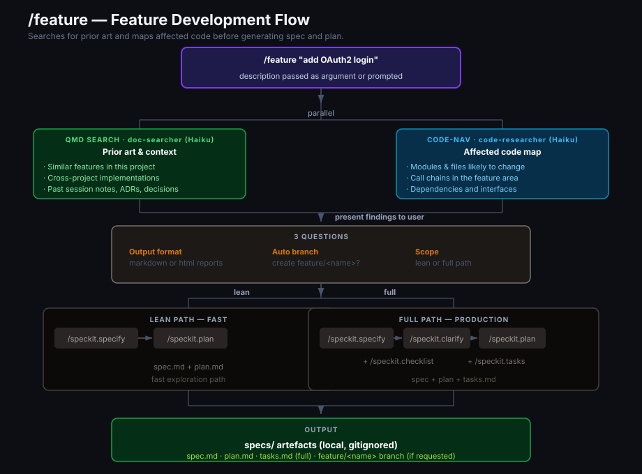
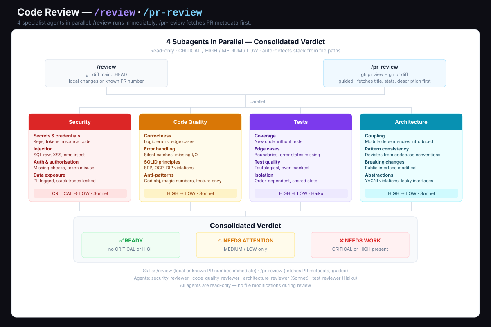

# Workflow

How a typical dev session looks with this setup.

---

## Session start

```
/recall
```

Always start here. `/recall` does two separate things:

1. **Engram** (session memory): `mem_current_project`, `mem_context` for recent history, and `mem_search` by topic (project scope first, then personal). Relevant hits are read in full with `mem_get_observation`.
2. **QMD** (reference docs only): specs, ADRs and `docs/`, through the `doc-searcher` agent.

If `/recall` reports no QMD collection configured, run `/project-setup` first; that does not affect the Engram part. If Engram does not respond, `/recall` says so and does not fall back to QMD, because QMD no longer holds session memory. See [troubleshooting](troubleshooting.md).

---

## Building a new feature



```
/feature "add OAuth2 login with GitHub"
```

Before spec-kit runs, `/feature`:
1. Searches QMD for prior art — both in the current project and personal collections
2. Uses `code-researcher` to map files and modules likely affected

Then asks three questions:
1. **Output format** — `markdown` (just `.md` files) or `html` (HTML reports + `.md`)
2. **Auto branches/commits** — create a `feature/<name>` branch automatically?
3. **Scope** — `lean` (specify → plan) or `full` (specify → clarify → checklist → plan → tasks)

Artefacts land in `specs/<feature-name>/`:
- `spec.md` — what you're building and why, with acceptance criteria
- `plan.md` — technical approach, data model, contracts
- `tasks.md` — phased task breakdown, dependency-ordered

None of this goes to the repo — `specs/` is gitignored.

---

## Writing code

No special commands. Claude uses Codegraph automatically (enforced in `CLAUDE.md`).

What this means in practice:
- Claude searches for a function → `codegraph_search`, not `grep`
- Claude traces a call chain → `codegraph_callers`, not reading files
- Claude estimates impact of a change → `codegraph_impact`

To find something specific without touching the main context:
```
/code-nav "where is the rate limiter middleware defined?"
```

---

## Reviewing changes



Two skills, same agents, different entry points:

| | `/review` | `/pr-review` |
|---|---|---|
| **Use when** | You want results fast, local or known PR | You want to see PR metadata first |
| **Entry** | Runs immediately | Asks for PR, shows title/stats, then runs |
| **Output** | Same verdict format | Same verdict format |

```bash
/review              # local staged changes
/review 42           # PR #42, no preview
/pr-review           # asks for PR, shows context first
```

All three use the same 4 agents in parallel: `security-reviewer`, `code-quality-reviewer`, `test-reviewer`, `architecture-reviewer`.

Verdict format:
```
SECURITY        [✅/⚠️/❌]  summary
CODE QUALITY    [✅/⚠️/❌]  summary
TESTS           [✅/⚠️/❌]  summary
ARCHITECTURE    [✅/⚠️/❌]  summary

VERDICT: ✅ READY | ⚠️ NEEDS ATTENTION | ❌ NEEDS WORK
```

---

## Committing

```
/commit
```

Staged diff → Conventional Commits message. Edit if needed, then `git commit`.

Format: `type(scope): description`

Types: `feat`, `fix`, `refactor`, `docs`, `test`, `chore`, `perf`, `ci`

---

## Checking docs

```
/doc-check
```

After a refactor or feature, checks which docs are now stale given the branch changes.

---

## Documenting decisions (ADRs)

Architecture Decision Records capture *why* a choice was made — the context, the tradeoffs, the alternatives considered. They're worth writing when you add a dependency, change an approach, or decide NOT to do something obvious.

### Automatic detection

`/save-session` runs `/adr-check` automatically before saving to Engram. It scans the diff for signals:

- **Strong signals** (almost always an ADR): new dependency, framework change, new external integration, new architectural pattern
- **Moderate signals**: auth strategy change, protocol change, new directory conventions

If candidates are found, it presents them and asks which to document before saving the session summary.

### Manual check

```
/adr-check
```

Run this any time — after a significant refactor, before a PR, or mid-session when you know a decision was made.

### Writing an ADR

```
/adr
```

The `adr` skill (from the built-in plugin) creates a structured ADR in `docs/adr/`. It prompts for context, decision, consequences, and alternatives considered.

ADRs in `docs/adr/` are **committed** — they're project documentation, not local context.

### ADR format

```
docs/adr/
└── 001-<short-title>.md
    ├── Context
    ├── Decision
    ├── Consequences
    └── Alternatives considered
```

---

## Ending a session

```
/save-session auth-refactor
```

Flow:
1. Runs `/adr-check` first — scans the diff for undocumented decisions and asks if you want to write them now
2. Saves durable learnings with `mem_save`, one observation per idea: decisions and their why (`decision`), non-obvious bugs and root cause (`bugfix`), conventions (`pattern`), findings about tools (`discovery` / `config`)
   - `mem_search` first: same topic means `mem_update`, already covered means skip
   - scope `project` for this repo, `personal` for facts about your own tools
   - if a save returns `judgment_required`, it is resolved with `mem_judge`
3. Closes with `mem_session_summary` (goal, discoveries, accomplished, next steps, relevant files, ADRs written)

Next time you run `/recall`, the memories are recovered from Engram.

> Nothing is written to disk. Engram is the only store for session memory; QMD is not re-indexed by `/save-session` (only if an ADR was written into `docs/`).

---

## Working rules

The global `~/.claude/CLAUDE.md` ships proportional rules, so simple work stays simple.

### When to delegate

Work inline by default. A subagent is used only when one of these applies, and it is named before delegating:

1. **Explore**: understanding unfamiliar code takes more than ~5 searches in a row.
2. **Parallel writers**: two or more independent tasks touching different files, several minutes each.
3. **Context handoff**: the session is very long; the next bounded unit goes to a fresh worker.
4. **Independent verification**: the change is high risk.

When in doubt, inline. The number of files or the size of the task alone does not decide. When delegating, pass exact paths (`spec.md`, `plan.md`, `tasks.md`, `SKILL.md`), not a paraphrase, and say which verification commands to run.

### Small vs large work

- **Small** (fits one session, resumable by reading the diff, contained risk): do it directly, no spec.
- **Large** (several sessions, external waits, or requirements that would not survive a compaction): use Spec Kit (`/feature`), then execute the tasks with `/run-tasks`.

### `/run-tasks`

```
/run-tasks specs/003-async-hc3
```

Without an argument it uses the most recent folder under `specs/`. It:
1. Reads `tasks.md` (only checks that `spec.md` and `plan.md` exist)
2. Groups pending tasks by phase, respecting order and dependencies
3. Runs tasks marked `[P]` with non-overlapping files as a parallel batch (one subagent per task, with the exact task text and allowed files); small or dependent tasks are done inline
4. Marks each task `- [x]` with an evidence line (`command: result`)
5. Applies the risk-based review to each phase's diff
6. Saves the decisions taken to Engram
7. Stops and reports; it never commits or pushes

### Test-first

When there is an executable test and a clear result: a failing test (RED) per requested rule, then implementation (GREEN), then refactor. Add a test for each existing behaviour you touch, nothing more. If a test makes no sense, say why and run the functional checks anyway.

### Risk-based review

At the end of a change, classify it:

- **Low** (docs, comments, no executable effect): quick re-read.
- **Medium** (normal change covered by tests): run the tests and report `<command>: <result>`.
- **High** (persisted data or migrations, security or auth, contracts other consumers use, concurrency, deployment, or no test would catch a regression): save the diff, run the security reviewer and the architect on it, one round of fixes for blockers, and raise whatever stays open as a decision.

Commit, push and PR are always your decision.

---

## Per-project setup

Run once when starting on a new project:

```
/project-setup
```

This single command:
1. Creates `docs/adr/`, `specs/`
2. Adds `specs/`, `.codegraph/`, `.specify/` to `.gitignore` (safe append — never overwrites existing content)
3. Initialises spec-kit and Codegraph (the latter interactively)
4. Runs `/setup-qmd` to index reference docs and specs (not session memory, which lives in Engram)
5. Shows `/stats` to confirm everything is operational

### What gets created locally

```
your-project/
├── docs/
│   └── adr/           ← architecture decision records (committed)
├── specs/             ← spec-kit artefacts (gitignored)
├── .codegraph/        ← code graph index (gitignored)
└── .specify/          ← spec-kit config (gitignored)
```

`docs/adr/` is the only new directory that gets committed — it's where ADRs live. Session memory is not in the project at all; it is in Engram.

### Spec-kit

`/feature` initialises spec-kit automatically on first use. No manual setup needed.

---

## Day-to-day command reference

| Situation | Command |
|-----------|---------|
| Start a session (Engram + docs) | `/recall` |
| New feature | `/feature "description"` |
| Review local changes | `/review` |
| Review known PR fast | `/review 42` |
| Review PR with context | `/pr-review` |
| Commit | `/commit` |
| Check stale docs | `/doc-check` |
| Find code | `/code-nav "question"` |
| End session (save to Engram) | `/save-session topic` |
| Run a spec's tasks | `/run-tasks specs/<feature>` |
| Setup new project | `/project-setup` |
| Token savings report | `rtk gain` |
| Setup status | `/stats` |
